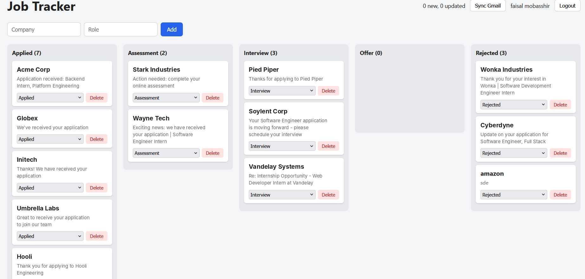

# Job Tracker

A Kanban board for job applications that fills itself from your Gmail inbox.

You log in with Google, click **Sync Gmail**, and the app reads your recent
emails, picks out the ones that are about job applications, and moves cards
across the board for you: Applied, Assessment, Interview, Offer, Rejected.
You can also add, move and delete cards by hand.



## How the sync works

The app asks Google for read-only access to your mail. It never sends,
deletes or changes anything, and it only reads the headers and a short
snippet of each email, not the full body.

Each email goes through three filters:

1. **Bulk mail is dropped.** Anything Gmail labels Promotions or Social, or
   that carries an unsubscribe header, is skipped.
2. **Known noise is dropped.** A blocklist of senders (event reminders, job
   alerts, bank statements) is skipped.
3. **Stage words decide the column.** The subject and snippet are checked
   for phrases like "regret to inform", "interview", "assessment" or
   "application received". The order matters: rejection phrases are checked
   before interview phrases, so "not moving forward" can't land in Interview.

Each processed email id is stored on its card, so clicking Sync twice never
creates duplicates. If a card for the same company already exists, the sync
updates its stage instead of making a new one.

## Tech stack

- **Frontend:** React, TypeScript, Vite
- **Backend:** Node.js, Express, TypeScript
- **Database:** MongoDB with Mongoose
- **Auth:** Google OAuth 2.0, with a signed httpOnly cookie for the session
- **Security:** the Google refresh token is encrypted (AES-256-GCM) before it
  is saved, and every card belongs to one user

## Run it locally

You need Node 20.19+ (or 22.12+), a local MongoDB, and a Google Cloud project.

1. In Google Cloud, enable the **Gmail API**, set up the OAuth consent screen
   (External, Testing mode, add yourself as a test user), and create a
   **Web application** OAuth client with this redirect URI:
   `http://localhost:5000/auth/google/callback`
2. Copy `server/.env.example` to `server/.env` and fill it in. Generate the
   two random keys with:
   `node -e "console.log(require('crypto').randomBytes(32).toString('hex'))"`
3. Start the server:
   ```
   cd server
   npm install
   npm run dev
   ```
4. In a second terminal, start the client:
   ```
   cd client
   npm install
   npm run dev
   ```
5. Open http://localhost:5173

## Known limits

- **Runs locally only.** It is not deployed.
- **Testing mode.** The Google app isn't verified, so only listed test users
  can log in, and Google expires the login about every 7 days.
- **Rule-based, not perfect.** The classifier is keyword rules tuned on one
  inbox. It misses some real emails and can mislabel others.
- **Card text is the email subject.** Emails rarely state the role cleanly,
  so the subject is used as a placeholder.